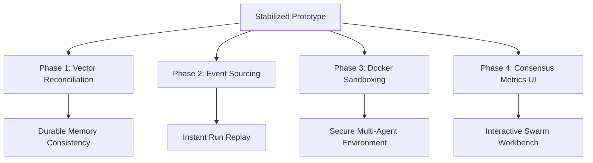

# CodingAgentsGO Roadmap

This document outlines the strategic roadmap for transitioning **CodingAgentsGO** from its current stabilized state to a fully robust, secure, and production-ready orchestrator.

---

## Phase 1: Vector Memory Reconciliation (Current Focus)
* **Goal**: Reconcile local vector memory retrieval against the durable ArtifactFlow event database to ensure across-session context availability and validation.
* **Key Tasks**:
  1. Extend `types.VectorStore` interface with a `GetMessage(ctx, id) (Message, error)` method.
  2. Implement database-level message retrieval in `ArtifactFlow`'s `afstate.Blackboard`.
  3. Rehydrate semantic search results in `internal/agent/history.go` by checking retrieved message visibility and matching against the database.
* **Value**: Enables historical memory across different agent runs while respecting message deletions/visibility updates.

---

## Phase 2: Event-Sourced Dynamic State Projection Layer
* **Goal**: Enable complete reconstruction of any run's runtime views (active roles, token usage, timeline) purely from the SQLite database event stream.
* **Key Tasks**:
  1. Define unified projection types to represent run snapshots.
  2. Implement an event replayer that rebuilds active workspace states from `run_events` and `messages` tables.
  3. Expose dynamic replay controls via CLI and Web UI.
* **Value**: Provides complete persistence and restart tolerance for long-running workflows without process memory overhead.

---

## Phase 3: Docker Sandboxing & Security Execution Policy
* **Goal**: Protect the host system by isolating arbitrary code running and high-privileged tools inside isolated containers.
* **Key Tasks**:
  1. Implement automatic container spin-up and health checks in `dockerrunner.go`.
  2. Define strict tool policy mapping (e.g. `coderunner` commands must run in Docker, while `writer` is checked for directory scope).
  3. Prevent local file mount escapes and network bypasses.
* **Value**: Secures the developer workspace, permitting safe execution of LLM-generated code.

---

## Phase 4: Enhanced Swarm Consensus & Metrics dashboard
* **Goal**: Provide visibility into parallel swarm runs, critiques, and decision syntheses.
* **Key Tasks**:
  1. Add UI components to display parallel responses side-by-side in the live dashboard.
  2. Render evaluation heatmaps showing scores and contradiction matrices generated by the Critic.
  3. Provide manual controls to override Synthesizer choices.
* **Value**: Enhances observability of multi-agent collaboration, debugging, and quality steering.
