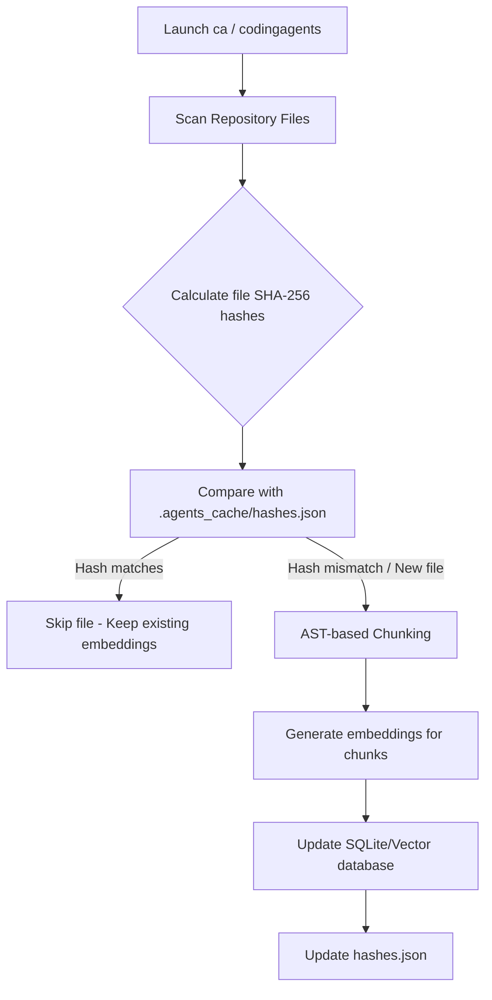

# Production-Readiness Proposals: CodingAgents & ArtifactFlow

This document outlines key architectural improvements to transform the research-prototype codebase into a robust, high-performance production system.

---

## 🚀 1. Incremental RAG Codebase Indexing (With Hash Caching)

### The Problem
Currently, the system does not index the codebase upfront because doing a full, naive scan on startup would block execution for minutes and overload local GPU/CPU resources with hundreds of embedding calls. 

### The Solution: File-Hash Cache & AST Chunking
By introducing an incremental codebase indexer, we only build embeddings once and update them incrementally.

#### Key Mechanics:
1. **Incremental Update:** A local metadata store (e.g., `.agents_cache/hashes.json` or a table in `artifactflow_agents.db`) maps `file_path -> sha256_hash`.
2. **AST-based Chunking:** Instead of chunking code by raw line count (which cuts functions in half), we use language-aware parsers (e.g. Go's native `go/parser` or Tree-sitter for other languages) to chunk code logically at function, method, or struct boundaries.
3. **Upsert Operations:** When a file changes, the system deletes old vector records for that file path and inserts the new chunk embeddings.

---

## 🔍 2. First-Class Semantic Search Tool

### The Problem
Agents currently navigate the codebase by manually listing folders, running text searches, and reading files (`explorer` tool). For large projects with hundreds of folders, this "blind walk" consumes vast amounts of context space and agent turns.

### The Solution: Semantic Search Tool
Once the codebase is indexed incrementally, we expose `memory_retriever` as a first-class tool for all agents:
* **Tool Signature:** `[TOOL: memory_retriever, ARGS: {"query": "where are database connections initialized?"}]`
* **Result:** Returns the top 3-5 most semantically matching code chunks, allowing the agent to jump directly to the correct file and function instantly.

---

## ⚡ 3. Rust-Go Shared Library Integration (C-Bindings)

### The Problem
The Go Orchestrator currently spawns the Rust sidecar engine as an external OS process and communicates via IPC sockets. This introduces process-startup overhead, OS scheduling latency, and IPC marshalling overhead.

### The Solution: Cgo / DLL Bindings
* Compile the core Rust engine as a shared library (`.dll` on Windows, `.so` on Linux).
* Bind the Rust engine directly to Go using Cgo or syscalls. This turns IPC calls into direct in-memory function pointer execution, achieving sub-millisecond latencies.

---

## 🛡️ 4. Dynamic Run-time Failover

### The Problem
If the local llama.cpp Gemma server encounters an error or runs out of VRAM/system memory, the entire run fails.

### The Solution: Cloud Fallback Provider
Implement a dual-backend failover chain:
* Try the local model sidecar (`Gemma-4-E4B`) first to ensure data privacy and zero cost.
* If a connection fails, timeout occurs, or VRAM is exhausted, automatically switch the summarizer/agent context to a secure cloud endpoint (like Gemini 1.5 Flash via OpenAI API compatibility) and notify the user:
  `[WARN] Local sidecar busy/failed. Temporarily failing over to Cloud backend...`

---

## 🛠️ 5. Granular Security Policies (HITL Whitelisting)

### The Problem
Currently, executing commands (`dockerrunner`) requires manual approval for every turn, even for safe commands like `go test ./...` or `git status`.

### The Solution: Action Whitelists
Add a policy schema inside `agents_config.json`:
* **Command Whitelisting:** Allow specific shell commands to execute automatically (e.g., `git diff`, `go test`).
* **Path Sandboxing:** Designate specific folders as "safe zones" where the writer tool can write/append without human confirmation, prompting only when modifications touch critical orchestration code.
